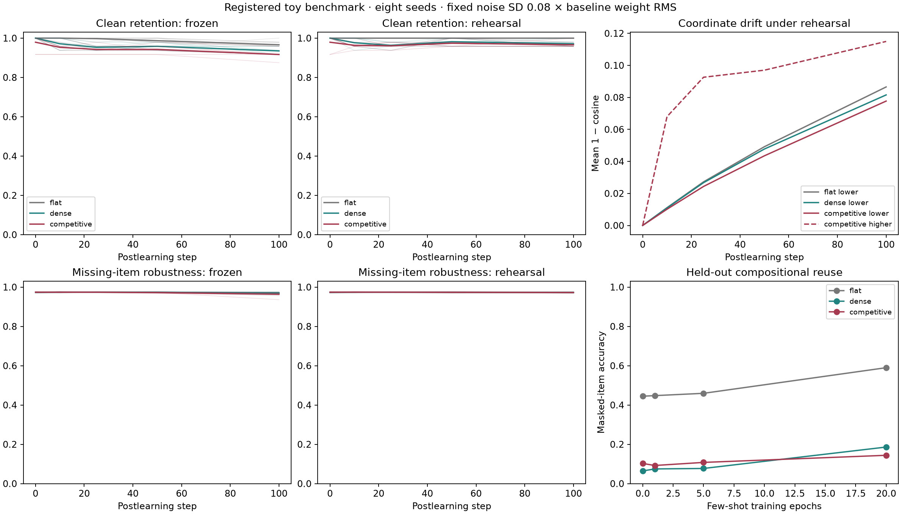

# Chunking, drift, and stability

A minimal falsifiable computational benchmark of learned competitive sequence
codes and feedback. **Provisional, Grossberg-inspired; not a reproduction of a
Masking Field, ART, or a biological model.** Results can fail the hypothesis.

The [frozen protocol](docs/protocol.md) separates learning-driven recoding from
postlearning drift, actual readout retention from analyst decodability,
clean retrieval from missing-item robustness, and old memory from new reuse.
It registers thresholds and all seeds before running experiments.

The [provisional theory](docs/theory-provisional.md) was first written and
committed in the local cognitive-system-theory repository before this code.
It distinguishes the source mechanisms from the proposed extensions.

**Completed result:** [Registered v1 report](RESULTS.md). No registered
competitive stability advantage was supported. Old item memories suffered,
higher responses were not more stable, and reuse was inconclusive. The task
had robustness ceiling effects and weak functional dependence on feedback.
This is a limited negative test, not a biological falsification.



## Reproduce

Python 3.11 or 3.12 and [uv](https://docs.astral.sh/uv/):

```sh
uv sync --locked
uv run --locked pytest -q
OPENBLAS_NUM_THREADS=1 OMP_NUM_THREADS=1 VECLIB_MAXIMUM_THREADS=1 uv run --locked python -m chunkdrift.run --output results/reproduction
MPLCONFIGDIR=.cache/matplotlib uv run --locked python -m chunkdrift.analyze results/reproduction
```

Use a fresh output directory: the runner refuses to overwrite prior runs.
Defaults use configs/registered.json (eight seeds; all conditions).
Results include raw measurements, loss traces, response/weight checkpoints,
configuration/source hashes and environment provenance. Seed reproducibility
is tested; exact floating point identity across BLAS/platforms is not promised.
The original run environment and commit are recorded in results metadata.

## Model and controls

Train on sensory reconstruction of items, pairs, then longer lists. The
competitive model has learned softmax list codes and a learned feedback path.
Controls include a smaller flat model and an exactly parameter-matched dense
noncompetitive path. Each gets the same exposures and reconstruction target.
Postlearning branches separately vary unconstrained synaptic noise and
continued sensory rehearsal. Frozen+noise is the noise-only condition;
rehearsal provides an external sensory error signal, never an old-output oracle.
Chronic and acute feedback/chunk/lower-population interventions expose causal
limitations. Held-out pair combinations test few-shot reuse on a separate branch.

The protocol and model document which Grossberg mechanisms are omitted.
Parameter equality does not establish equality of effective capacity.
Stable output is measured, never imposed by a constraint or projection.

## Sources

- Kazerounian & Grossberg (2014), [Real-time learning of predictive recognition categories that chunk sequences of items stored in working memory](https://doi.org/10.3389/fpsyg.2014.01053).
- Natrajan & Fitzgerald (2025), [Stability through plasticity: Finding robust memories through representational drift](https://doi.org/10.1073/pnas.2500077122).
- Rule & O'Leary (2022), [Self-healing codes](https://doi.org/10.1073/pnas.2106692119).
- Kalle Kossio et al. (2021), [Drifting assemblies for persistent memory](https://doi.org/10.1073/pnas.2023832118).

These motivate distinct mechanisms; this repository does not replicate or
falsify those papers.

To rerun the post-run checkpoint audit and descriptive diagnostics:

```sh
OPENBLAS_NUM_THREADS=1 OMP_NUM_THREADS=1 VECLIB_MAXIMUM_THREADS=1 uv run --locked python -m chunkdrift.audit
MPLCONFIGDIR=.cache/matplotlib XDG_CACHE_HOME=.cache uv run --locked python -m chunkdrift.diagnostics
```

These supplementary commands target the archived `results/registered-v1` run.
The source/configuration hashes recorded there refer to the original frozen
implementation. The supplementary audit/diagnostic files were added later.
