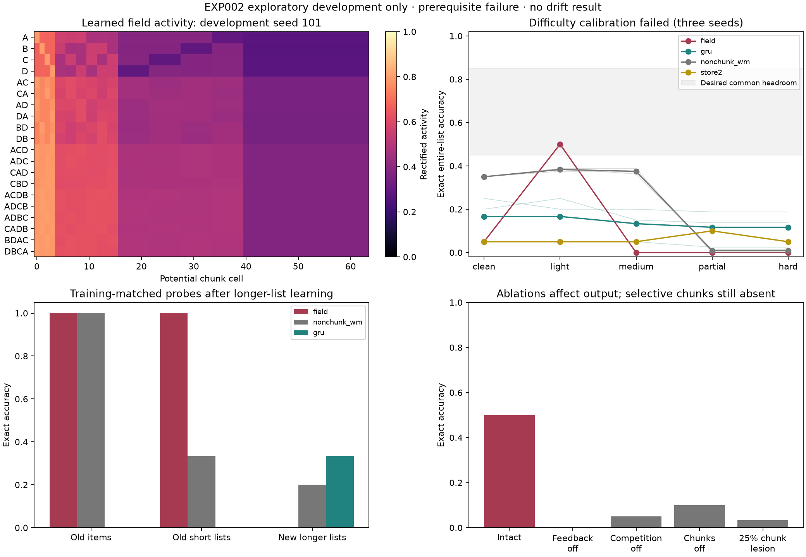

# EXP002 — temporal chunk formation before drift

**Current outcome: stopped at development. The central hypothesis was not tested.**

[Read the result and limits](RESULTS.md). A new temporal model transcribes
source working-memory and Masking Field components, but did not establish
learned chunk emergence or a fair calibrated task. A second source-unit variant
restored selectivity, but its untrained-filter control already did as well. Confirmatory
seeds remain unused. Stage 2/3 experiments were not run or interpreted.

EXP001 is preserved unchanged at the repository root. All new work is here.

- [Source investigation and fidelity decisions](docs/source-audit.md)
- [Exploratory development plan](docs/development-plan.md)
- [Frozen readiness and prospective confirmation protocol](docs/protocol.md)
- [Numerical readiness configuration](configs/readiness-v1.json)
- [Machine-readable stopping decision](results/readiness-v1.json)
- [First calibration and audit evidence](results/development-calibration/)
- [Source-unit variant and declared conversion](unit_consistency/PLAN.md)
- [Second calibration and untrained-filter control](results/unit-consistency-calibration/)

## Reproduce

From the repository root, using the existing pinned environment:

```sh
uv sync --locked
uv run --locked pytest -q tests exp002/tests
```

Development programs refuse to overwrite their main result directories. Run
in a separate checkout with an empty `exp002/results/` directory to reproduce
all development (the tracked archive remains the original):

```sh
OPENBLAS_NUM_THREADS=1 OMP_NUM_THREADS=1 VECLIB_MAXIMUM_THREADS=1 uv run --locked python -m exp002.develop_probe
OPENBLAS_NUM_THREADS=1 OMP_NUM_THREADS=1 VECLIB_MAXIMUM_THREADS=1 uv run --locked python -m exp002.develop
OPENBLAS_NUM_THREADS=1 OMP_NUM_THREADS=1 VECLIB_MAXIMUM_THREADS=1 uv run --locked python -m exp002.diagnose
```

Readiness can be recomputed from the archive without overwriting it:

```sh
uv run --locked python -m exp002.readiness --output exp002/results/readiness-reproduction.json
```

The audit and plot scripts reproduce supplementary artifacts from the original
saved records. They overwrite only their generated audit/plot files, so use a
scratch checkout if preserving their exact bytes matters:

```sh
OPENBLAS_NUM_THREADS=1 OMP_NUM_THREADS=1 VECLIB_MAXIMUM_THREADS=1 uv run --locked python -m exp002.audit
MPLCONFIGDIR=.cache/matplotlib XDG_CACHE_HOME=.cache uv run --locked python -m exp002.plot
```

The audit also verifies all EXP001 files remain identical to af5272b.
Development has three seeds, not the twelve reserved confirmation seeds.
No command here runs synaptic drift experiments or bypasses the Stage 1 gate.



To reproduce the second exploratory source-unit variant in a scratch checkout
with its result directories absent:

```sh
OPENBLAS_NUM_THREADS=1 OMP_NUM_THREADS=1 VECLIB_MAXIMUM_THREADS=1 uv run --locked python -m exp002.unit_consistency.run
OPENBLAS_NUM_THREADS=1 OMP_NUM_THREADS=1 VECLIB_MAXIMUM_THREADS=1 uv run --locked python -m exp002.unit_consistency.calibrate
OPENBLAS_NUM_THREADS=1 OMP_NUM_THREADS=1 VECLIB_MAXIMUM_THREADS=1 uv run --locked python -m exp002.unit_consistency.diagnose
MPLCONFIGDIR=.cache/matplotlib XDG_CACHE_HOME=.cache uv run --locked python -m exp002.unit_consistency.plot
```

The calibration command reuses the unchanged GRU trained on the identical first
calibration streams, so reproduce the first development commands beforehand.
