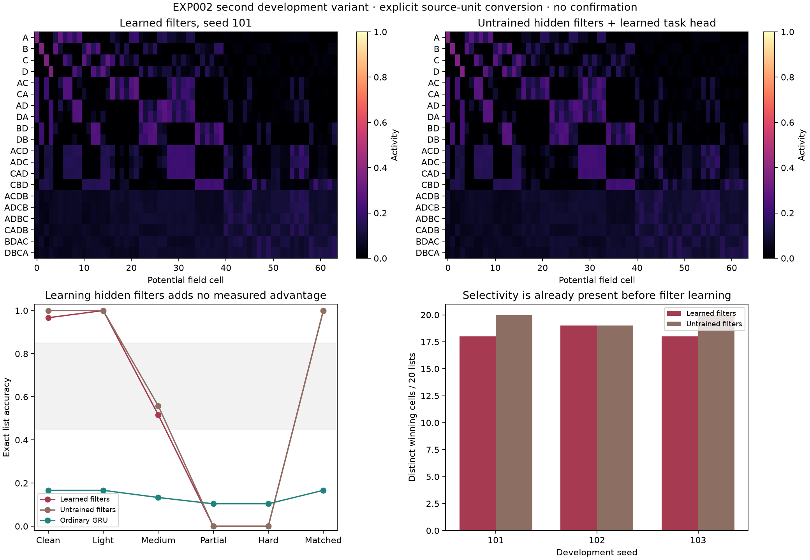

# EXP002: stopped at development; stability hypothesis not tested

**Date:** 2026-10-16. **Status:** A source-traceable temporal model was implemented
and explored in two development variants, but learned chunk emergence was
not established. The first failed selectivity; the source-unit variant restored
selectivity that was already present without filter learning. No Stage 1
confirmation, Stage 2 recoding interpretation, or Stage 3 drift/robustness
experiment was performed. This is not a negative test of the central hypothesis.

The gate prevented another scientifically inadequate stability experiment.
EXP001 and all its negative findings remain byte-for-byte unchanged.

## What was implemented

The investigation inspected the original equations in Kazerounian & Grossberg
(2014), pp. 9–12, and the cognitive circuit in Grossberg & Kazerounian (2011),
pp. 454–455. The [source audit](docs/source-audit.md) and [source manifest](docs/source-manifest.json)
identify documents, pages, hashes, implementation searches and explicit choices.
No verified reference implementation of this temporal system was found in the
bounded searches; general ART libraries were not substituted for it.

The code transcribes STORE2 as a reference and implements continuous cognitive
working-memory layers, habituative gates, shunting size/overlap-dependent
Masking Field competition, and activity-gated top-down modulation. The main
circuit combines the 2011 dynamics with learned 2014 instar filters and a
separately stored outstar-style feedback memory. It uses actual sequential
item pulses, not a softmax layer or an item-position input array.

**This is a new synthesis of source components, not a validated reproduction.**
The 2011 paper hand-sets its sequence weights. Some details of the 2014
formulation are ambiguous (including printed versus prose input gain and the
indexed feedforward inhibition); these were not silently guessed and called
source-faithful. The main model instead uses the 2011 cognitive equations.
Rectified firing outputs, learned feedback, timing, anatomical candidate
allocation and omitted acoustic/ART processes are disclosed in the audit.

A mathematically transcribed component does not establish that the assembled
network has the source model's properties. In particular, this synthesis did
not reproduce the selective winner-take-all list dynamics needed for EXP002.

## Redesigned task and controls

Inputs arrive on four item channels in temporal order. Lists have 1–4 distinct
items, including recurring pairs alone and embedded in longer lists. States
must retain the sequence through a delay before an ordered response. Difficulty
varies delay, distractor activity, sensory noise and partial cues. An omitted
item is weak nonspecific sensory evidence, distinct from literal silence.
Trial boundaries are supplied; segmentation is not learned. Items cannot
repeat within one list because rank coding is not implemented.

The common task target is an ordered response with an end/padding symbol.
This is a supervised task readout; the hidden chunk filters never receive
correct sequence identities. A linear recursive least-squares readout can use
both lower and higher states, so success is not architecturally forced through
chunks. A separately trained nonchunking cognitive-WM control uses the same
lower dynamics. A literal STORE2 reference and an ordinary trainable GRU also
receive the identical raw streams and response targets.

The full field has 1,972 learned filter/readout parameters and the GRU 2,078.
This is close, not exact parameter matching. The GRU has recurrent memory,
long-retention initialization and full backpropagation through time. Its
supervision and optimizer differ from the field's local sensory filter learning
plus least-squares readout. Neither equal parameter count nor equal presentations
establish equal effective capacity or convergence.

Each development seed received 30 presentations of each of 10 old items/short
lists, then 30 of each of 10 longer lists: **600 identical training trials per
model per seed**, with no old sensory replay during the second phase. All
three seeds (101,102,103) are retained. Calibration used new corruption streams
and five conditions, yielding **4,800 evaluation records** over four models.
Novel development compositions exclude the reserved confirmatory longer lists.

An initial six-condition source probe used development seed 101, pulse durations
.75/2/6 and feedback gains 1/8, with 160 learning trials each. All six settings
are retained; each produced only four distinct clean-probe winners. Gain 8 and
pulse .75 were retained as declared source-based choices, not because they
maximized an experimental advantage. No extra learning-rate search was needed
under the development plan because the filters changed appreciably.

## First synthesis: development observations

These are descriptive results from development, not preregistered hypothesis
tests. The readiness thresholds were frozen **after** examining development,
before any confirmatory data; they are not retroactive confirmatory criteria.

### Selective sequence chunks were not established

On training-matched probes after learning, all three seeds had:

- Four distinct winning cells for twenty trained sequences (coverage 20%).
- Winners restricted to the four **single-item-sized cells**.
- All 64 potential field cells above the .2 activity threshold on these noisy
  probes: distributed activation, not selective list winner-take-all dynamics.
- Different-order winner discrimination of 72.22% for lists with the same item
  set, insufficient by itself to show meaningful list categories.

Filters changed by 10.53%, 7.88%, and 9.78% in relative norm. Thus learning
occurred, but weight change did not establish useful chunk formation. Anatomy
already provides candidate item subsets and balanced initial weight orderings;
it is not unconstrained discovery of temporal structure.

The activity map and temporal traces reveal a concrete concern: lower states
are driven toward saturation, and the field lacks the selective list dynamics
needed to interpret a hierarchy. Source-component synthesis, candidate density,
feedback strength, normalization and omitted acoustic matching are plausible
implementation/design issues. These alternatives were not experimentally
isolated and must not be turned into established explanations.

### Old functions survive only under the measured task conditions

A separate replay audit regenerated the full field and readout for all three
seeds, bit for bit. New training-matched probes use delay 2 and sensory noise
.005, without distractors. Exact accuracy was:

| Probe group | After old learning | After longer-list learning |
|---|---:|---:|
| Old single items | 100% | 100% |
| Old short lists | 100% | 100% |
| New longer lists | 0% | 0% |

This demonstrates retention of the measured old functions, **without acquisition
of the longer-list function**. It does not satisfy the central prerequisite.
It also does not establish LTM invariance under arbitrary new learning or
synaptic change.

After the longer-list phase, other controls' training-matched exact scores were:

| Control | Old items | Old short lists | Longer lists |
|---|---:|---:|---:|
| Nonchunking cognitive WM | 100% | 33.33% | 20.00% |
| Ordinary GRU | 0% | 0% | 33.33% |

The GRU had not adequately acquired and retained this task under this schedule.
Those numbers cannot support a claim that chunking is better than a competent
nonchunking learner. Equal training budgets are not an excuse to compare
against an underlearned control.

### Feedback and competition matter, but that is insufficient

The fixed learned field readout scored 50% exact accuracy averaged across all
twenty training-matched probes. The following acute interventions changed it:

| Intervention | Exact accuracy |
|---|---:|
| Intact | 50.00% |
| Feedback removed | 0.00% |
| Competition removed | 5.00% |
| Whole chunk path removed | 10.00% |
| Random 25% field-cell silencing | 3.33% |

These are measurable causal effects of circuit interventions on output. They
are not a demonstrated causal effect of **selective learned sequence chunks**:
longer-list accuracy was already zero, and the selective chunk construct had
failed. Acute lesions also change the readout's input distribution. A sham and
matched lower-population lesion were not run; selective necessity is not
claimed. With only three development seeds and exploratory analysis, no
confirmatory statistical significance is claimed.

### Difficulty calibration failed

The intended shared exact-accuracy range was .45–.85, chosen without requiring
a chunk advantage. No tested nonclean condition placed both full field and
GRU in that range.

| Condition | Full field exact | GRU exact | Nonchunking WM exact |
|---|---:|---:|---:|
| Noise-free, delay .5 | 5.00% | 16.67% | 35.00% |
| Light interference, delay 2 | 50.00% | 16.67% | 38.33% |
| Medium interference, delay 4 | 0.00% | 13.33% | 37.50% |
| One partial cue, delay 6 | 0.00% | 11.67% | 0.83% |
| Hard partial cue, delay 10 | 0.00% | 11.67% | 0.83% |

The noise-free .5-delay test differs from training in both noise and delay;
it is a distribution-shift diagnostic, not a training-matched acquisition
estimate. The nonmonotonic performance warns that calibration is not a simple
one-dimensional difficulty scale. Aggregate 50% in the light condition hides
failure on all longer lists. This run traded EXP001's ceiling for acquisition,
floor and distribution-shift problems; it did not solve task validity.

On sixteen unseen development compositions, full-field exact accuracy was 0%
and real-item token accuracy 18.75%; GRU exact was 2.08%, token 44.44%.
These descriptive outcomes do not establish compositional reuse.

## The stopping decision

The [frozen readiness protocol](docs/protocol.md) and numerical
[configuration](configs/readiness-v1.json) were committed at `4e2839b` before
running the [readiness checker](results/readiness-v1.json). The checker reports:

- Integration refinement: passed on the tested clean endpoints.
- Shared difficulty calibration: failed.
- Distinct learned chunk winners: failed.
- Same-set order discrimination: failed.
- Executable confirmatory task condition: absent, rather than fabricated.

**Status: STOPPED_AT_DEVELOPMENT. Central stability hypothesis: NOT_TESTED.**

All twelve reserved confirmatory seeds (1001–1012) remain unused. Stage 1
confirmation was not run; Stage 2 and Stage 3 were neither implemented as
executed experiments nor interpreted. Their prospective design, functional
relationship metrics, separate intrinsic-plasticity versus external-perturbation
branches, numerical criteria and prerequisites are specified in the protocol.
An executable successor protocol is required after a valid chunk model exists.

No external stochastic **synaptic** perturbation experiment was run in EXP002.
The noise used here is sensory corruption for task development. Learning-driven
A/B states are archived but no recoding/drift conclusion is drawn from them.
In particular, this work does not require higher-level activity to remain fixed:
future tests must separate changing neuronal patterns from preserved functional
cue-to-response and order relationships.

## Second development variant: explicit source-unit conversion

A critical comparison after the first failure found a compatibility issue in
our synthesis. The 2014 instar filters sum to one. The 2011 field separately
divides its input by list size, with listed fixed physical weights averaging
.1 over their connected items (singleton .1; triples .15/.1/.05). Combining
normalized filters directly with that divisor introduces a second size
normalization and disadvantages larger cells. This is a model-construction
issue in our synthesis, not an empirical finding against either paper.

A [separate development plan](unit_consistency/PLAN.md) specified the current
conversion physical_W=.1*size*normalized_W and likewise M, with no correct
sequence templates, extra training labels, or protected outputs. The original
model and all its failures remain intact. This conversion matches the listed
weight scales; it is an inferred adapter, not proof of the authors' complete
parameterization or reproduction of either original system.

The same six pulse/feedback conditions were evaluated on all three development
seeds (18 attempts, 160 training trials each). At pulse .75, winner counts
improved to 18–20 and all same-set order pairs had distinct winners. Longer
pulse settings often collapsed again. These outcomes are all archived in
[unit-consistency-development](results/unit-consistency-development/).

We then repeated calibration with **the identical 600 training streams, labels,
and budget** as the first attempt, keeping pulse .75 and source gain 8. The
ordinary GRU weights were reused from its identical prior training, so it got
neither a hidden advantage nor a new handicap. A crucial added control left
all hidden filters untrained while learning the same task readout.

| Condition | Learned filters exact | Untrained hidden filters exact | Ordinary GRU exact |
|---|---:|---:|---:|
| Clean, delay .5 | 96.67% | 100% | 16.67% |
| Light interference | 100% | 100% | 16.67% |
| Medium interference | 51.67% | 55.83% | 13.33% |
| Partial cue | 0% | 0% | 10.42% |
| Hard partial cue | 0% | 0% | 10.42% |
| Training-matched | 100% | 100% | 16.67% |

Learned-filter winner counts were 18/19/18, compared with 20/19/20 for the
untrained-filter control. Weights changed by approximately 5.7–5.9%, but
learning them improved neither winner coverage nor performance on any tested
condition. Both variants achieved only 6.25% exact accuracy on unseen
development compositions. All raw data and the
[second readiness result](results/unit-consistency-calibration/readiness.json)
are retained. These are descriptive development comparisons, not confirmatory
significance tests.

This materially changes the diagnosis: **selective field activity can be
obtained, but the present task has not established that it emerges through
hidden-filter learning or that this learning is functionally necessary.** The
balanced anatomy/initialization already provides a rich ordered code. Task-head
learning is real, but cannot be relabeled as discovery of temporal chunks.
Absence of an observed learning benefit is not proof that no useful learning
occurred under any metric; it is a failure to establish the required construct.

This version also retains ceiling/floor problems and an underacquired recurrent
control, so it still lacks a fair shared measurement range. Its worst clean
endpoint refinement difference is 3.657% at the tested steps, above the 2%
readiness target; numerical refinement remains unfinished for this variant.
No threshold or seed was changed to make it pass. No confirmatory or drift run
was performed. The second variant is more informative than silently accepting
the first failure, but does not authorize a central-hypothesis conclusion.

The numerical readiness screen for the second variant is computed from measured
winner gains, learned-versus-untrained performance, shared calibration and
step-refinement errors. It is not hard-coded to fail. Its screens were specified
after exploration and are explicitly not preregistered tests of these data.

## Verification and reproducibility

- **36 tests passed** across EXP001 and EXP002, including independent equation
  derivatives, complementary STORE2 gating, low-rank versus full masking
  coefficients, shunting bounds, silence/modulatory feedback, sensory-gated
  learning, ordinary GRU finite-difference gradients, independent batch versus
  recursive ridge, and the prohibition on interpreting later stages after a
  failed or merely ready Stage 1.
- Clean endpoint refinement from dt .05 to .025/.0125 changed the tested full
  states by at most **0.5114%**. This is numerical consistency, not successful
  reproduction of source dynamics or biological validation.
- [Audit](results/development-calibration/audit.json): all three field/filter/task
  readout learning trajectories reproduced bit for bit. Every one of the
  **678 tracked EXP001 files** matches commit af5272b byte for byte.
- All six initial development attempts, calibration trial records, trained
  filters/readouts, activity maps, temporal traces, source hashes and parameter
  choices are retained under results/. Source PDFs are not redistributed.
- [Temporal dynamics](results/development-calibration/temporal-dynamics.png)
  were opened and visually inspected along with the overview.

The development plan was written before exploratory execution in this chat,
but its archival Git commit occurred afterward. It is not an external
preregistration. Environment/source hashes in the audit were recorded
retrospectively. After the readiness freeze, supplementary replay, plots and a
full-equation derivative test were added. That test initially compared a
finite-step derivative too tightly to an instantaneous derivative; Richardson
extrapolation corrected the numerical test without changing production model
code, data, readiness thresholds or results.

## Implications for the theory

Do not reinterpret this failure as evidence that chunks cannot preserve memory,
or adjust the hypothesis to make it fit. The implementation has not yet
realized the proposed explanatory mechanism. The work identifies a necessary
next validation step: reproduce selective temporal list dynamics in a verified
source architecture, then establish acquisition and headroom for both chunking
and nonchunking learners before collecting central-hypothesis evidence. The unit-consistency variant
additionally requires evidence of learning beyond its already selective initial
code, rather than relying on a pre-existing code scaffold.

That likely requires resolving source details and testing a fuller attentive
matching circuit rather than adding an arbitrary gain, assigning correct
chunk templates, forcing a bottleneck, or declaring every ablation effect a
chunk effect. Those extensions have not been made here. The appropriate
scientific outcome is an archived construction/calibration failure and no
stability verdict.
